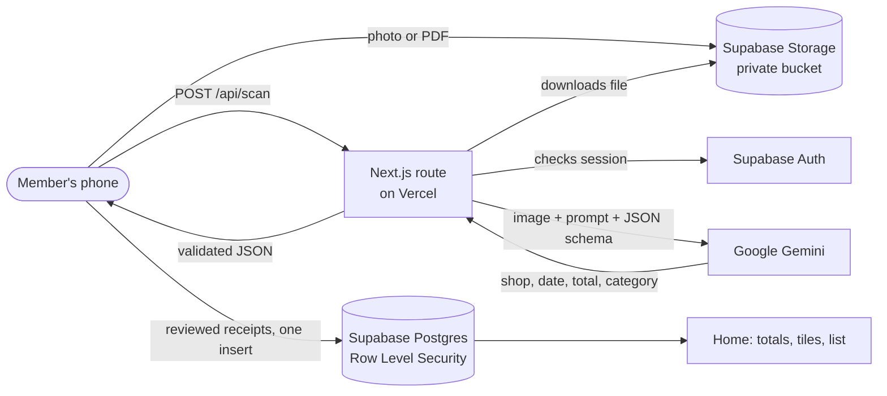

<div align="center">

# Receipt Scanner

**Snap a receipt. AI reads the shop, date and total. Your club's expenses add themselves up.**

[](https://receipt-scanner-nine-sigma.vercel.app/)


CEE Final Project · Semester 1/2026 · **P2 Receipt Scanner** for Lumina Club's Finance team

</div>

---

## The problem

Club members send receipt photos in LINE, and the treasurer types every amount into a spreadsheet by hand. It's slow, and amounts get mistyped or lost.

**Receipt Scanner** turns a photo into a saved expense in seconds. Each member scans their own receipts, checks what the AI read, and sees their spending by month and by category.

## Features

| | |
| --- | --- |
| 📷 **Scan from camera or file** | Use the in-app camera, or upload a JPG, PNG or PDF up to 5 MB. Scanning starts as soon as a file is chosen. |
| 🧠 **AI reads the receipt** | Google Gemini returns shop, date, total and category as structured JSON. It works with Thai and English receipts and converts Buddhist-era years (2569 → 2026). |
| 🧾 **Many receipts at once** | One photo or a multi-page PDF can hold several receipts; each one becomes its own entry. |
| ✅ **Check before saving** | Every field is editable. Warnings in plain words for unclear scans, likely duplicates and future dates. |
| 📊 **Monthly dashboard** | Monthly total, month picker, change vs. last month, and category tiles sized by share. Tap a tile to filter. |
| 🗂️ **Your own expense list** | Grouped by day. Open a receipt to see the original photo or PDF, edit it, or delete it with **Undo**. |
| 🏷️ **Custom categories** | Pick *Other* and name it ("Club T-shirts"); it becomes your own category with its own colour. |
| 🔐 **Accounts** | Sign up, log in, log out, forgot password. Each member only ever sees their own receipts. |
| 🌗 **Light and dark** | Theme toggle, remembered per device; follows the phone's setting on first visit. |
| 📱 **Built for phones** | Thumb-reachable buttons, iOS-style motion, and a Thai font (Google Sans) next to Geist for English. |

## Challenging requirements

| Tier | Feature | How the app meets it |
| --- | --- | --- |
| ⭐ **S** | **Computer Vision** | The receipt image is the input: Gemini reads it and the extracted shop, date and total are saved to the user's list. |
| 🏅 A | Document Processing | A PDF with several receipts is read page by page into separate entries. |
| 🥈 B | Dashboard | Monthly total, category share tiles and month-on-month change, all from real saved data. |
| 🥉 C | Dark Mode | Sun/moon toggle on the home screen. |
| 🥉 C | Notification | In-app toasts triggered by real events: receipt saved, receipt deleted (with Undo), duplicate found. |

> Tier S alone is worth 20/20; the rest are extras.

## How it works



1. The browser shrinks photos to 1600 px JPEG (PDFs stay as they are) and uploads them to a **private** Storage bucket under the user's own folder.
2. `POST /api/scan` checks the session, downloads the file with the user's own permissions, and sends it to Gemini with a JSON response schema.
3. The server validates the answer (real date, positive total, THB only, known category) before the user sees it.
4. The user reviews and saves. All receipts from one file are saved in **one insert**, so a batch is never half-saved; a lost response can be retried safely.

## Tech stack

| Layer | Choice |
| --- | --- |
| Framework | Next.js 16 (App Router, Cache Components), React 19, TypeScript |
| Styling | Tailwind CSS 4, Geist + Google Sans (Thai) |
| Auth, database, files | Supabase Auth · Postgres with Row Level Security · Storage |
| AI | Google Gemini API via `@google/genai` (structured JSON output) |
| Hosting | Vercel |

## Run it locally

**You need:** Node.js 20 or newer, a free [Supabase](https://supabase.com) project, and a [Gemini API key](https://aistudio.google.com/apikey).

```bash
git clone https://github.com/Calculuszz/Receipt_Scanner.git
```

```bash
cd Receipt_Scanner && npm install
```

```bash
cp .env.example .env.local
```

Fill in `.env.local`:

| Variable | Where to find it | Used in |
| --- | --- | --- |
| `NEXT_PUBLIC_SUPABASE_URL` | Supabase → Project Settings → API | Browser and server |
| `NEXT_PUBLIC_SUPABASE_ANON_KEY` | Same page, the publishable / anon key (safe in the browser; RLS protects data) | Browser and server |
| `GEMINI_API_KEY` | Google AI Studio | **Server only.** Never prefix with `NEXT_PUBLIC_`. |
| `GEMINI_MODEL` | A current Gemini Flash model name from Google AI Studio | Server only |

Set up the database: open the Supabase **SQL editor** and run [`supabase/schema.sql`](supabase/schema.sql). It creates the tables, Row Level Security policies, the private `receipts` bucket (images and PDF) and the default categories.

```bash
npm run dev
```

Open http://localhost:3000, create an account and scan a receipt.

### Scripts

| Command | What it does |
| --- | --- |
| `npm run dev` | Start the dev server |
| `npm run build` | Production build (needs `.env.local`) |
| `npm run lint` | ESLint |
| `node scripts/test-receipt-validation.cjs` | Offline tests: AI answer validation |
| `node scripts/test-receipt-batch.cjs` | Offline tests: multi-receipt save and retry |
| `node scripts/test-receipt-cleanup.mjs` | Offline tests: unused-file cleanup safety |

## Deploy

1. Import the GitHub repo into **Vercel**.
2. Add the four environment variables above in Vercel → Settings → Environment Variables, then redeploy.
3. In Supabase → Authentication → URL Configuration, set **Site URL** to your Vercel URL and add `https://<your-app>.vercel.app/` and `https://<your-app>.vercel.app/reset-password` to **Redirect URLs** (sign-up and password-reset emails link there).

## Project structure

```text
app/
  page.tsx                 Home: month picker, totals, category tiles, list
  scan/page.tsx            Camera / upload, AI review, save all
  receipts/[id]/page.tsx   Receipt detail: photo or PDF, edit, delete
  login/ signup/           Accounts
  reset-password/          Set a new password from the email link
  api/scan/route.ts        Server route that calls Gemini
components/                Auth, expense list, receipt detail, shared UI
lib/
  receipt-validation.ts    Checks and cleans the AI's answer
  receipt-batch.ts         One-request save with safe retry
  receipt-file.ts          Image shrinking, PDF checks
  ui.ts                    Category colours/icons, money and date helpers
supabase/schema.sql        Tables, RLS, storage bucket, seed categories
```

## Privacy and security

- **Row Level Security** on every table: a member can only read and change their own receipts and categories.
- **Private storage:** receipt files live under `<user id>/…` and are only shown through short-lived signed URLs.
- **Secrets stay on the server:** the Gemini key is only read inside the API route; `.env*` files are git-ignored.
- **Mock data only:** test receipts are our own, with card numbers and names covered.

## Team

| Name |
| --- |
| Akkarapon Krongyut |
| Sirapop Pewngam |
| Thapakorn Suwanpho |

## License

[MIT](LICENSE) © 2026 Lumina Club Receipt Scanner Team
